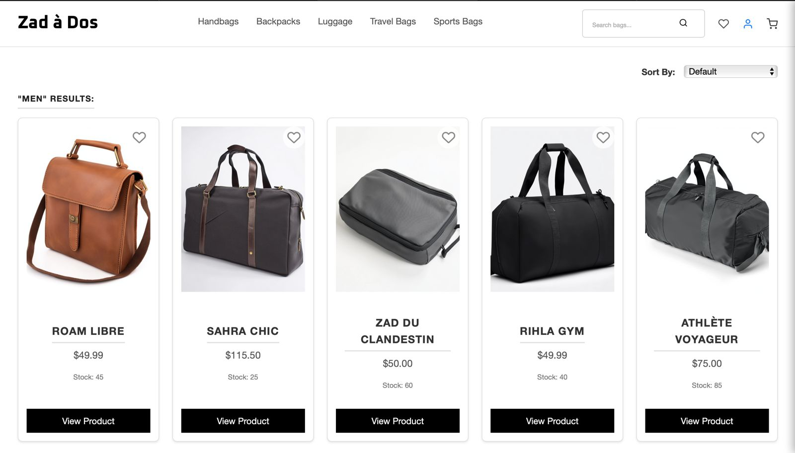
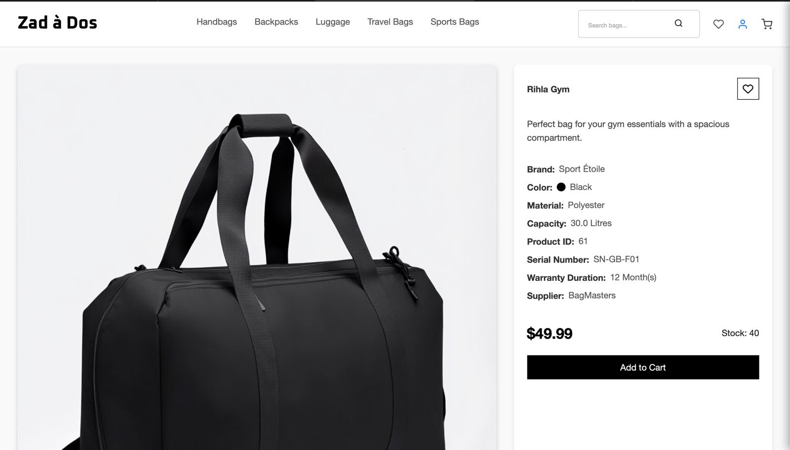
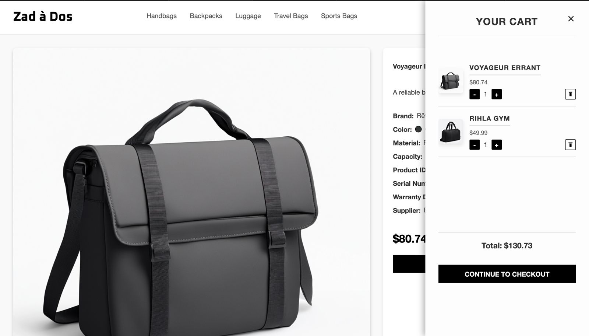
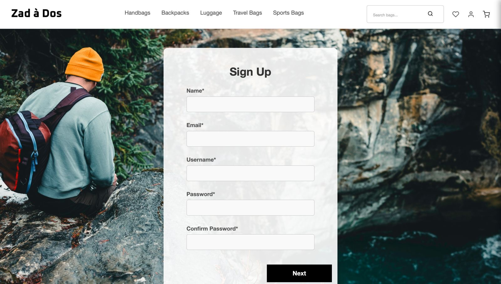
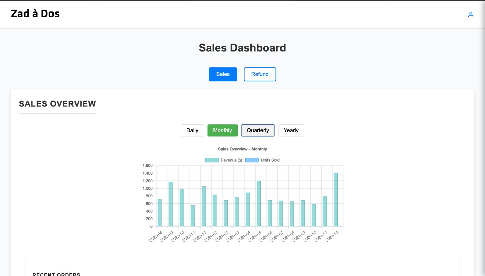
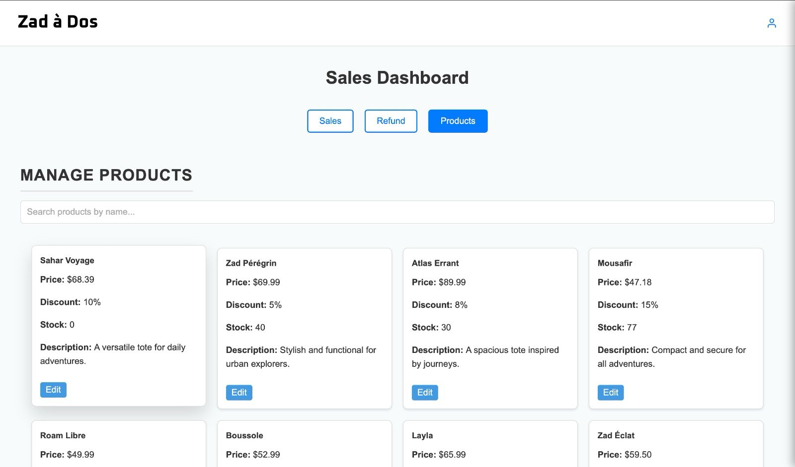
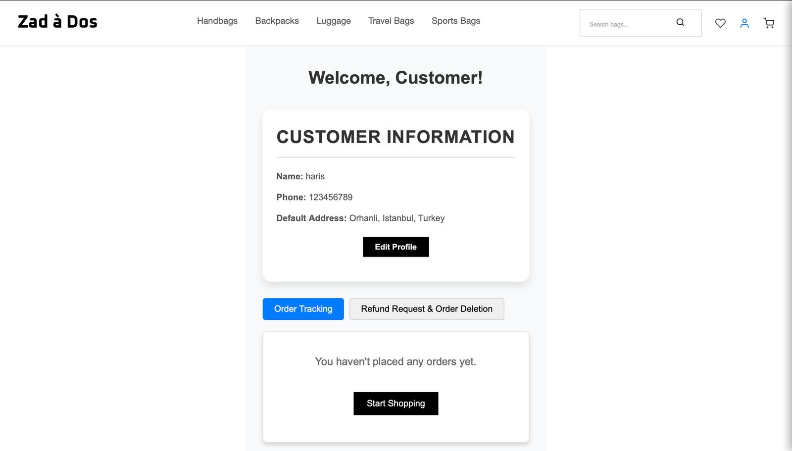

<div align="center">

# Accounts Management System - Empowering Precision, Enhancing Productivity

[](https://reactjs.org/)
[](https://nodejs.org/)
[](https://www.mysql.com/)

**Accounts Management System** streamlines financial transactions, inventory, and accounting for small businesses, helping increase profits. With a user-friendly interface and role-specific tools, it boosts efficiency, financial precision, and overall operational performance.

[View Demo](https://your-demo-link.com) 

</div>

---

## ✨ Features

### General Features
- **Centralized Financial Management**: Track sales, purchases, expenses, and profits.
- **Inventory Monitoring**: Real-time updates on stock levels and inventory details.
- **User Role Management**: Tailored access for employees, branch managers, and owners.
- **Customizable Dashboard**: Provides insights into financial health and key metrics.

### Employee Features
- Access to personal contracts, bonuses, fines, and leave details.
- Ability to refute fines and apply for sick or annual leaves.

### Branch Manager Features
- Manage transactions including sales and expenses.
- Issue or withdraw fines for employees.
- Send payment reminders to vendors via email.

### Owner Features
- Access all contracts, transactions, and profit data.
- Department-wise financial performance analysis.
- All functionalities available to branch managers.

---

## 🛠️ Tech Stack

- **Frontend**: React.js, HTML, CSS, and JavaScript for a dynamic and responsive user interface.
- **Backend**: Node.js for handling server-side operations and API endpoints.
- **Database**: MySQL, designed to store and manage critical business data efficiently.

---

## 🚀 Quick Start

### Prerequisites

```bash
node >= 16.x
npm >= 8.x
```

### Installation

1. Clone the repository
```bash
git clone https://github.com/yourusername/zad-a-dos.git
cd zad-a-dos
```

2. Install dependencies
```bash
npm install
```

3. Start the development server
```bash
npm start
```

🌐 Access the application at `http://localhost:3000`

---

## 📸 Screenshots

### Customer Interface

<details>
<summary>Click to expand</summary>

#### Home Page

*Engaging landing page with featured products and categories*

#### Product Listings

*Comprehensive product catalog with advanced filtering*

#### Product Details

*Detailed product information with high-resolution images*

#### Shopping Cart

*Intuitive cart management system*

#### Wishlist

*Personal wishlist for saved items*

#### Authentication

*Secure user login system*


*User-friendly registration process*

#### Checkout

*Streamlined checkout experience*
</details>

### Admin Interface

<details>
<summary>Click to expand</summary>

#### Sales Dashboard

*Comprehensive sales analytics and reporting*

#### Product Management

*Advanced product management interface*

#### Customer Management

*Detailed customer insights and management*
</details>

---

## 📁 Project Structure

```
src/
├── assets/         # Static resources
├── components/     # Reusable UI components
├── pages/          # Page components
├── services/       # API integrations
├── styles/        # Global styles
└── App.js         # Main component
```

---
## 🤝 Contributing

## 👥 Team

Meet the talented developers behind ACM:

- ROHAAN AHMAD
- Arshia Yaser

---

